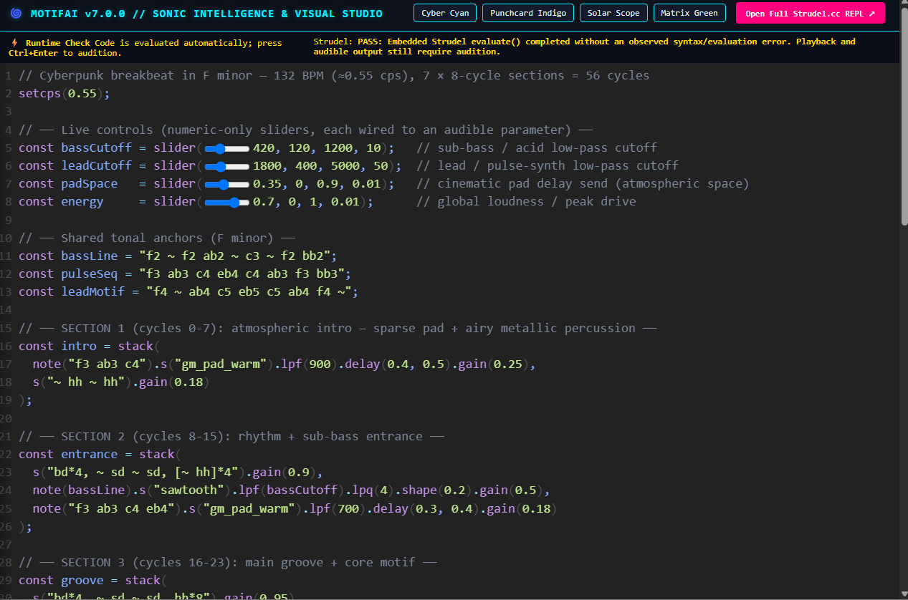
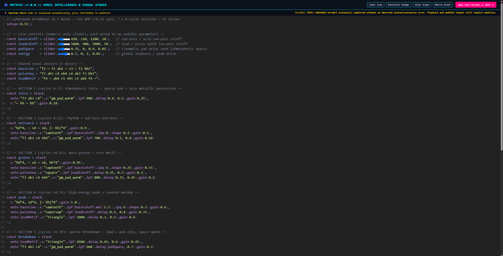
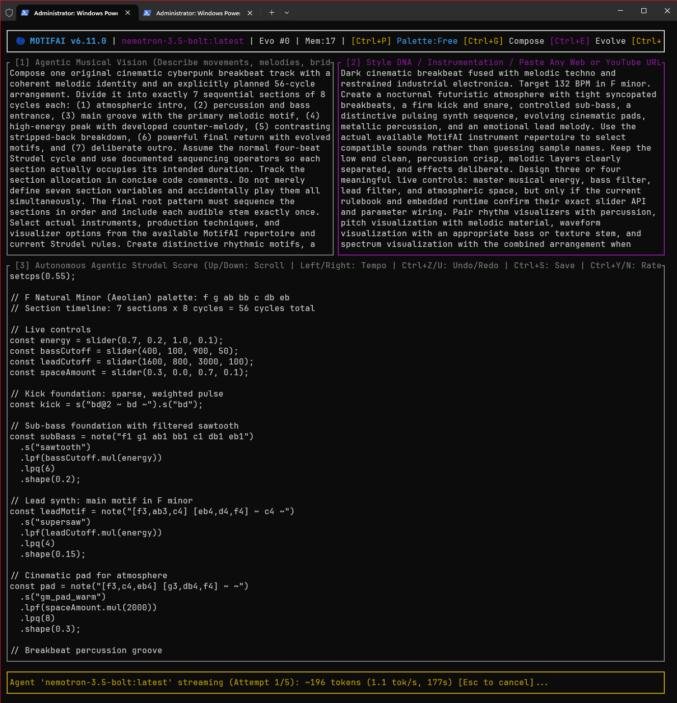

# 🌀 MotifAI v7.3.0

**An autonomous, local-AI symphonic song architect built on Rust and Strudel.**

MotifAI bridges locally installed Ollama text-generation models—including compatible Qwen, DeepSeek, GLM, Nemotron, Devstral, and Mistral variants—with the Strudel.cc live-coding music environment.

As of v7.3.0, MotifAI combines:

- A work-mode-aware Composition Orchestrator.
- The 65-architecture Master Composition & Performance Palette.
- Recipe-based request compilation with task-aware inference profiles and live NDJSON token streaming.
- Evidence-ranked Engram Planner with finding-specific feedback, memory selection visibility, and repeated runtime-failure retrieval.
- A two-stage verification loop: Conservative Lexical Preflight followed by Embedded Strudel REPL Runtime Evaluation.

Describe your musical vision and style DNA, and MotifAI autonomously structures, codes, validates, and arranges an executable Strudel JavaScript composition in real time. You control the creative steering: use **Smart Auto**, switch to **Free-Form** for zero blueprint injection, or opt in to **Golden Scorebook** tracks and **Empirical Memory Advisory** whenever you choose[cite: 3, 6, 7, 10].

## 🖼️ Screenshots

### Embedded Visual Studio

*Runtime evaluation status, theme controls, wired sliders, and the active score in the embedded Studio (v7.0.0).*

*A wide editor view showing the evolving multi-section arrangement and interactive controls (v7.0.0).*

### Terminal composition workflow

*The terminal workflow combines the musical brief, style direction, and live generation output (v6.11.0).*

---

## ✨ Core Features

### 🎨 Master Composition & Performance Palette · `Ctrl+P`

Browse and select from **65 composition architectures** spanning small, medium, extended, and concert scales, **31 instrument role palettes**, **13 production palettes**, and **11 visual telemetry families**.

Choose one of three modes:

- **Smart Auto:** Matches one flexible architecture seed to each request.
- **Free-Form (OFF):** Uses zero blueprint or palette injection.
- **Pinned Blueprint:** Locks a specific architecture through `Ctrl+P` or by writing `blueprint:` in your prompt.

### 🎼 Work-Mode-Aware Orchestration

MotifAI automatically classifies each request into one of four work modes: **New Composition**, **Targeted Edit**, **Composition Evolution**, or **Technical Repair**. Narrow edit requests preserve unrelated working stems, while evolution passes inspect existing stem roles and develop the arrangement without freezing section maps.

### ⚡ Ollama-Metadata-Aware Inference Profiles & Live Streaming

MotifAI discovers Ollama text-generation models and excludes embedding-only models from `Ctrl+M`. It uses reported model capabilities, context length, and parameter count to select a task-aware profile; parameter count is only a size hint and does not predict exact VRAM use. Context and output limits can be overridden with `MOTIFAI_NUM_CTX` and `MOTIFAI_NUM_PREDICT`, subject to the selected model's reported context limit.

Tokens stream live over NDJSON with throughput telemetry. The request compiler distinguishes new compositions, targeted edits, evolutions, and compact repairs, and reports the effective work mode, profile, context, output cap, and thinking policy in diagnostics. Ollama prompt-token counts are logged alongside the conservative local estimate when the server provides them.

### 🔬 Two-Stage Verification & Stateful Surgical Repair

Every candidate score must first pass **Conservative Lexical Preflight**, which checks balanced delimiters, mini-notation brackets, tempo presence, wired sliders, and active musical stems. It also repairs standalone `@number` filter strings, such as `.lpf("@200")` into `.lpf(200)`, without rewriting your melodies.

Candidates that pass preflight are evaluated inside the pinned `@strudel/repl@1.3.0` browser runtime when it is available. A missing or unavailable runtime is reported as **unverified**, never as a successful evaluation. Failed preflight/runtime checks can enter a bounded repair flow; compact repair uses a lower-temperature policy and preserves the failed candidate for diagnosis.

### 📀 Opt-In Golden Scorebook · `Ctrl+B` / `Ctrl+T`

Manage your local `knowledge/golden_tracks` folder through an interactive overlay. Pin up to **two reference tracks** or use weighted stochastic rotation. Golden Tracks are **OFF by default** and are never injected unless you explicitly enable them.

### 📚 Strudel Production Intelligence

Frequency-weighted, phrase-aware retrieval dynamically pulls up to **three curated Strudel syntax and DSP cards** from `knowledge/strudel_production_library.json`, based on your vision, style DNA, and any active compiler/runtime errors.

### 🗄️ Conditional Empirical Memory · `Ctrl+A` / `Ctrl+K` / `Ctrl+Y` / `Ctrl+N`

MotifAI records AST and runtime outcomes alongside explicit **Like** (`Ctrl+Y`) and **Revise** (`Ctrl+N`) signals. Prompt injection stays **OFF by default** until you turn Memory Advisory on with `Ctrl+A`.

### 🧠 Engram Planner · evidence-ranked memory for v7.3.0

**v7.3.0 update:** Engram now closes the feedback loop. `Ctrl+K` shows the latest eligible/relevant/selected findings, their estimated token costs, and whether the prompt compiler included or trimmed them. Users can rate an individual provenance-backed musical finding without treating a whole-track rating as approval of every detected feature. Repeated embedded Strudel runtime failures are stored against their diagnostics and become retrievable after the evidence threshold is met. Advisory injection remains opt-in.

`src/engram_planner.rs` separates memory retrieval from memory persistence. `SonicIntelligence` remains the source of durable experiments, findings, and feedback; the Engram Planner is a pure request-time planner that reads those records and chooses a small, auditable subset for one generation. It adds no tokenizer dependency, does not change the memory JSON schema, and does not save model chain-of-thought.

Memory must pass an evidence gate before it can enter a prompt:

- A preference finding must have provenance, be non-heuristic and non-descriptive, and have at least two explicit user signals with a decisive approval rate (at least 75% approval or at most 25%).
- A technical warning must be a non-heuristic AST or embedded-runtime diagnostic with at least two recorded technical failures.
- Heuristic-only findings, missing provenance, single observations, mixed preference evidence, and descriptive counts are excluded.

Eligible findings are ranked using term overlap with the current vision and style, confidence, epistemic status, evidence strength and consistency, and recency. Evidence loses weight with a 180-day half-life. The planner uses the user's current direction as its search query; it omits the full existing score so identifiers and code text do not overwhelm the request. Tie-breaking is deterministic. Selection is capped at eight notes and four per memory category, with each note limited to 240 characters.

The memory block receives a bounded share of the selected model's reported context window: 1.5%, with a 192-token floor and a 512-token ceiling. The estimate reuses MotifAI's conservative character-based fallback because Ollama model families do not share one tokenizer. It is explicitly an estimate, not a DeepSeek tokenizer applied to unrelated models. When Ollama reports `prompt_eval_count`, `forge_debug.log` records it beside the full-prompt estimate and the actual-to-estimated ratio so behavior can be compared across installed models.

`ENGRAM_MEMORY_PLAN` diagnostics report the model, budget, eligible and relevant counts, selected finding IDs, relevance hits, and scores; they do not write memory statements to the log. The prompt labels retrieved notes as untrusted evidence, not instructions, and the normal recipe sanitizer still processes the advisory before sending it to Ollama. Memory injection remains opt-in through `Ctrl+A`. If no supported finding matches the current request, the planner reports that no relevant evidence is available. If relevant evidence exceeds the memory budget, it reports that separately and injects none of it.

Use `Ctrl+K` to open **Engram Memory Review**. It shows the most recent plan's eligible, relevant, and selected counts, the selected notes and their estimated token costs, and whether the request compiler included the notes or trimmed them to fit. The planner can produce this local preview while injection is OFF; the advisory is sent to Ollama only while `Ctrl+A` is ON. In the review, use Up/Down to choose a provenance-backed, non-heuristic musical or experiential finding from the active composition, then `Y` or `N` to record feedback against that finding alone. These keys do not rate the whole composition; `Ctrl+Y` and `Ctrl+N` remain whole-composition feedback. When generation exhausts its repair budget on an embedded runtime failure, MotifAI stores the failed experiment and attaches the technical failure to its runtime diagnostic so repeated failures can later be retrieved by Engram.

### 🕰️ Session Time Machine & Non-Destructive Exports

Step backward with `Ctrl+Z` and forward with `Ctrl+U` through generated and evolved scores. Cancel an in-flight generation safely with `Esc`. Use `Ctrl+S` to save both `masterpiece.strudel.js` and timestamped backups in `exports/`.

### 🔒 Hardened Local Studio & Safe Web Reference Scraping

MotifAI serves the local Visual Studio at `127.0.0.1:7777` using Base64-only editor hydration to prevent HTML comment injection, token-verified runtime reports, and client heartbeat tracking.

Pasted HTTP(S) reference URLs are streamed with a **256 KB cap**, stripped of script/style tags, blocked from private/loopback networks, and isolated as untrusted reference data. Each redirect destination is checked, DNS results are checked and pinned for that request, and redirect count is bounded.

---

## 🛠️ Prerequisites & Installation

You need **Rust** and **Ollama** installed to run MotifAI.

### Step 1: Install Ollama

**Windows:** Download and install Ollama from [ollama.com/download/windows](https://ollama.com/download/windows).

**Linux:** Run the official install script in your terminal:

`curl -fsSL https://ollama.com/install.sh | sh`

#### Recommended environment settings: keep-alive & context

MotifAI v7.3.0 chooses a base context/output profile by task and reported model metadata, then clamps context to the model's reported limit where available. The recipe compiler estimates the complete system-plus-user request conservatively, trims optional references in order, and stops with an actionable error if the mandatory brief, rules, and existing score still exceed the effective input/output budget. `strudel_rules.md` is resolved from the project directory; set `MOTIFAI_STRUDEL_RULES` to an alternate rulebook path if needed. If the required rules cannot be read, generation stops visibly.

- **14B models:** 32,768 tokens.
- **24B–32B models:** 16,384–24,576 tokens.

These are policy defaults. Actual memory use and performance depend on model quantization, Ollama version, runtime offload behavior, and available GPU/system memory.

To keep models warm in memory between runs on Windows:

1. Press `Win + R`, type `sysdm.cpl`, press Enter, and select **Environment Variables**.
2. Add a User variable named `OLLAMA_KEEP_ALIVE` with the value `-1` or `20m`.
3. Fully quit Ollama from the Windows system tray, then relaunch it.

### Step 2: Pull the Recommended AI Model

Open a terminal and pull a coding model. **`qwen2.5-coder:14b`** is a useful interactive starting point, while larger models can be selected through `Ctrl+M` when their memory and latency costs fit your system.

- **Recommended interactive default:** `ollama pull qwen2.5-coder:14b`
- **Optional heavy model:** `ollama pull qwen2.5-coder:32b`

### Step 3: Install Rust & Launch MotifAI

1. Install Rust from [rustup.rs](https://rustup.rs) if you have not already.
2. Clone the repository:
   `git clone https://github.com/ShamelesAbyss/MotifAI.git`
3. Enter the project directory:
   `cd MotifAI`
4. Run the verification test suite:
   `cargo test`
5. Launch MotifAI:
   `cargo run --release`

---

## ⚙️ Optional Environment Overrides

MotifAI works out of the box with zero configuration, but the following environment variables are available for custom setups:

- **`STRUDEL_MODEL`**: Overrides the initial Ollama model selected at startup. Default: `qwen2.5-coder:14b`.
- **`MOTIFAI_COMPOSITION_BLUEPRINT`**: Sets the initial Master Palette mode to `auto` (default), `off` (Free-Form), or a specific blueprint ID.
- **`MOTIFAI_NUM_CTX`**: Overrides the automatic context window size. Valid range: `4096` to `131072`.
- **`MOTIFAI_NUM_PREDICT`**: Overrides the maximum generated token cap per pass. Use `-1` for unlimited output or a value from `512` to `32768`.
- **`MOTIFAI_STRUDEL_KNOWLEDGE`**: Points to a custom production-knowledge JSON file. Default: `knowledge/strudel_production_library.json`.
- **`MOTIFAI_COMPOSITION_BLUEPRINTS`**: Points to a custom blueprint-archive JSON file. Default: `knowledge/composition_blueprints.json`.

---

## 🎛️ How to Use the Forge

When MotifAI launches, it presents a three-pane Terminal User Interface (TUI). Press `Tab` to cycle focus between panes.

### Pane 1: Agentic Musical Vision

Describe your desired composition, movements, energy contour, melodies, bridges, solos, live sliders, or targeted edits. You can also include `blueprint:` to request a specific architecture inline.

### Pane 2: Style DNA / Reference Scraper

Specify genre, synthesis techniques, and rhythmic feel, or paste any public web/YouTube URL to scrape metadata context into the prompt.

### Pane 3: Autonomous Agentic Strudel Score

View and scroll through the generated Strudel JavaScript score, nudge the tempo in real time, or step through your Undo/Redo generation history.

---

## ⌨️ Keybindings

### Generation, Evolution & History

- **`Ctrl+G` or `F5` · Compose:** Builds a brand-new composition from the current Musical Vision and Style DNA.
- **`Ctrl+E` · Evolve:** Feeds the active score back into the orchestrator to develop sections, transform motifs, or apply targeted edits.
- **`Ctrl+Z` · Undo Score:** Returns to the previous score snapshot in the session history and syncs it to the Studio.
- **`Ctrl+U` · Redo Score:** Moves forward to the next score snapshot in the session history and syncs it to the Studio.
- **`Esc` · Cancel / Close / Exit:** Closes an open modal overlay, aborts an in-flight generation without quitting, or exits MotifAI when idle.

### Master Palette & Context Controls

- **`Ctrl+P` · Master Palette Overlay:** Opens the Master Composition & Performance Palette browser. Use **Up/Down** to browse, **Enter/Space** to apply, **A** for Smart Auto, **O** for Free-Form (OFF), and **R** to rescan.
- **`Ctrl+T` · Toggle Golden Tracks:** Turns Golden Scorebook reference injection ON or OFF.
- **`Ctrl+B` · Golden Scorebook Overlay:** Opens the interactive Golden Scorebook for `knowledge/golden_tracks`. Use **Up/Down** to navigate, **Space/Enter** to pin or unpin up to two tracks, **T** to toggle Golden mode, **C** to clear pins, and **R** to rescan.
- **`Ctrl+A` · Toggle Memory Advisory:** Turns Empirical Memory Advisory prompt injection ON or OFF.
- **`Ctrl+R` · Rescan Scorebook:** Rescans `knowledge/golden_tracks` for newly added `.strudel.js`, `.js`, or `.mjs` files.

### Playback & Local Studio

- **`Ctrl+L` · Launch Local Studio:** Opens the embedded Visual Studio in your browser at [http://127.0.0.1:7777/studio](http://127.0.0.1:7777/studio), with automatic REPL runtime evaluation, interactive sliders, visualizers, and theme switching. Press `Ctrl+Enter` in the browser tab to audition audio.
- **`Ctrl+O` · Open on Strudel.cc:** Pushes the current score directly into the full public Strudel REPL at [strudel.cc](https://strudel.cc/#).
- **Left/Right Arrow keys in Pane 3 · Nudge Tempo:** Adjust the top-level `setcps()` tempo down or up by `0.02` CPS (approximately 4.8 BPM) directly from the TUI.
- **Up/Down Arrow keys in Pane 3 · Scroll Score:** Scroll through the generated Strudel code.

### Feedback, Saving & Model Selection

- **`Ctrl+Y` · Like (Endorse):** Records explicit user approval for the active composition in Sonic Intelligence memory.
- **`Ctrl+N` · Revise (Reject):** Records explicit revision feedback for the active composition in Sonic Intelligence memory.
- **`Ctrl+S` · Save & Archive:** Writes the active score to `masterpiece.strudel.js` and saves a non-destructive timestamped copy to `exports/`.
- **`Ctrl+M` · Cycle Models:** Switches between all auto-discovered local Ollama models and displays the active inference profile.

---

## 🔍 Verification & Evidence Transparency

MotifAI maintains strict separation between verification stages across the TUI, logs (`forge_debug.log`), and empirical memory[cite: 3, 4, 6, 10].

### 1. Static Preflight Passed

The source passed lexical delimiter, mini-notation, slider-arithmetic, and stem-usage checks in `strudel_ast.rs`[cite: 3, 8].

### 2. Embedded REPL Evaluation Passed

The pinned `@strudel/repl@1.3.0` browser instance executed `setCode()` and `evaluate()` without throwing a syntax or evaluation error.

### 3. Auditioned / User Approved

Passing static preflight and REPL evaluation does **not** automatically prove audible output[cite: 3, 6, 8, 10]. Press `Ctrl+Enter` in the Studio to audition playback, then use `Ctrl+Y` to endorse compositions you genuinely like.

---

*Disclaimer: MotifAI is an experimental algorithmic composition studio. Musicality and synthesis complexity depend on the selected local LLM and your hardware environment.*
